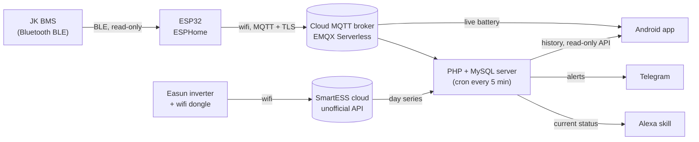

# One dashboard for your battery (JK BMS) and your inverter (Easun/SmartESS) with an ESP32

> 🇪🇸 [Versión en español](README.es.md)

How to bring the data of a **LiFePO4 battery with a JK BMS** (Bluetooth) and of an **Easun solar inverter with a wifi
dongle** (SmartESS cloud) into one place, see it from your phone **even when you are away from home**, get alerts
when the battery is low or full, and ask Alexa how the batteries are doing.

It is written from a real build, mistakes included: what cost time and how it was solved is in each chapter and
summarised in [8. Security and common problems](tutorial-en/08-security-and-troubleshooting.md).

> **Read-only.** Nothing described here writes to the BMS or to the inverter: no setting is changed, and charging or
> discharging is never switched on or off. If you ever want to *control* something, do it in a separate project and with
> much more care: this is an electrical installation holding 15 kWh of energy.

> **A note on the code.** The configuration files and source code keep their original Spanish comments, and the MQTT
> topics and sensor names are Spanish (`solar/bateria/sensor/soc/state`, "voltaje", "corriente"…). The tutorial explains
> everything in English; rename the topics to your taste if you like.

## What you will end up with

- An **Android app** with three tabs: *Now* (charge percentage, animated energy flow, how long the battery will last),
  *Today* (kWh produced and consumed, power and charge charts) and *History* (per day and per month).
- **Telegram alerts**: battery low, critical, full, or the system stopped sending data.
- **Alexa**: "Alexa, open *my solar home*" → "The battery is at 61 percent and discharging at about 290 watts…".
- **Your own history**, because the inverter's cloud only keeps the current day.
- A **family version of the app** that carries none of your passwords inside.

## Architecture

The key ideas:

1. **The BMS accepts only one Bluetooth connection at a time** and Bluetooth only reaches a few metres. An ESP32 next to
   the batteries connects to the BMS and forwards it over wifi to an MQTT broker on the internet. That way the phone sees
   it from anywhere.
2. **The inverter does not talk to the BMS** (in this build). Its data comes from the SmartESS cloud, which has an
   unofficial API. Its battery percentage is an estimate from voltage and is **not reliable**: the good percentage is the
   BMS one.
3. **The inverter's cloud keeps no history**, only the current day. That is why a small server collects it every 5 minutes
   and stores it.
4. Everything the user sees (app, Telegram, Alexa) **comes from the server or the broker, using read-only users**.

## What you need

| What | What for | Approx. cost |
|---|---|---|
| LiFePO4 battery with a **JK BMS** with Bluetooth (tested with a JK-B2A20S20P) | Source of the real percentage | — |
| **Easun inverter** with a wifi dongle and an account in the **SmartESS** app | Production, consumption | — |
| A classic **ESP32** (DevKit with CP2102 or CH340) and a **USB data cable** | BLE → wifi bridge | €5–8 |
| A 5 V / 1 A USB charger | To power the ESP32 next to the batteries | €3 |
| A free **EMQX Cloud** account (Serverless plan) | MQTT broker | free |
| A **server** with Apache, PHP 8 and MySQL, always on (a VPS, a Raspberry Pi…) | History, alerts, Alexa | whatever you have |
| A PC with Windows, Linux or Mac | To build ESPHome and the app | — |
| Android Studio | To build the app | free |
| An Amazon developer account (free) | Alexa skill | free |
| Telegram | Alerts | free |

Free tiers have limits that change over time. Check them on the official pages.

## Contents

1. [ESP32 and BMS: read the battery over Bluetooth and publish it](tutorial-en/01-esp32-bms.md)
2. [MQTT broker: get the data onto the internet safely](tutorial-en/02-mqtt-broker.md)
3. [The inverter: the SmartESS API](tutorial-en/03-inverter-smartess.md)
4. [The server: collector, history and API](tutorial-en/04-server-collector.md)
5. [The Android app](tutorial-en/05-android-app.md)
6. [Telegram alerts](tutorial-en/06-telegram-alerts.md)
7. [Alexa](tutorial-en/07-alexa.md)
8. [Security and common problems](tutorial-en/08-security-and-troubleshooting.md)

If you only want the battery on a dashboard, chapters 1 and 2 plus the MQTT part of the app are enough. The inverter,
the server, Telegram and Alexa are layers you can add later, one at a time.

## Tested with

ESPHome 2026.10 (ESP-IDF 5.5), `syssi/esphome-jk-bms` (`main` branch), Python 3.12, PHP 8.0, MariaDB/MySQL, Apache 2.4,
Android Studio with AGP 9.1, Kotlin 2.4, Gradle 9.3, compileSdk 36 and minSdk 26, Node 24 for the skill tests.

## Warnings

- The **SmartESS API is unofficial**: it was worked out from community projects and can change without notice (it did
  change during this build; see chapter 3). Use it only with your own account and with care.
- This project is **not affiliated** with JK, Easun, SmartESS, EMQX, Telegram or Amazon.
- Percentages and estimates are indicative. Do not use this as the only protection of an electrical installation.

## Where the code is

Each chapter explains the why and the important parts, and points to the folder with the full code:
`esp32/`, `servidor/` (server), `android/`, `alexa/`, `script-pc/` and `docs/` (sample SmartESS responses).

## License

Code and documentation under the **MIT** license (see `LICENSE`). Use it, change it and share it; no warranty.
The app icon is generic: replace it with your own in `android/app/src/main/res/mipmap-*` and `drawable-nodpi`.
