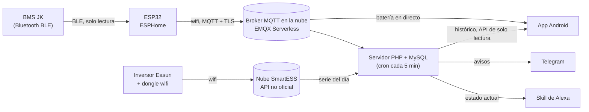

# Un solo panel para tu batería (BMS JK) y tu inversor (Easun/SmartESS) con un ESP32

Cómo juntar en un mismo sitio los datos de una **batería LiFePO4 con BMS JK** (Bluetooth) y de un
**inversor solar Easun con dongle wifi** (nube SmartESS), verlos desde el móvil **también fuera de casa**, recibir
avisos cuando la batería esté baja o llena y preguntarle a Alexa cómo van las baterías.

Está escrito a partir de un montaje real, con sus tropiezos incluidos: lo que costó y cómo se resolvió está en
cada capítulo y resumido en [8. Seguridad y problemas típicos](tutorial/08-seguridad-y-problemas.md).

> **Solo lectura.** Nada de lo que se explica aquí escribe en el BMS ni en el inversor: no se cambia ningún ajuste, ni se
> activa o desactiva la carga o la descarga. Si algún día quieres controlar algo, hazlo con un montaje aparte y con
> mucho más cuidado: se trata de una instalación eléctrica con 15 kWh de energía.

## Qué conseguirás

- **App Android** con tres pestañas: *Ahora* (porcentaje de carga, flujo de energía animado, cuánto durará la batería),
  *Hoy* (kWh producidos y consumidos, gráficas de potencia y de carga) e *Histórico* (por días y por meses).
- **Avisos por Telegram**: batería baja, crítica, llena, o el sistema ha dejado de enviar datos.
- **Alexa**: «Alexa, abre *mi casa solar*» → «La batería está al 61 por ciento y se está descargando a unos 290 vatios…».
- **Un histórico propio**, porque la nube del inversor solo guarda el día en curso.
- Una **versión de la app para la familia** que no lleva dentro ninguna contraseña tuya.

## Arquitectura

Las ideas clave:

1. **El BMS solo admite una conexión Bluetooth a la vez** y el Bluetooth alcanza unos metros. Un ESP32 junto a las baterías
   se conecta al BMS y lo reenvía por wifi a un broker MQTT en internet. Así el móvil lo ve desde cualquier sitio.
2. **El inversor no habla con el BMS** (en este montaje). Sus datos salen de la nube de SmartESS, que tiene una API no
   oficial. Su porcentaje de batería es una estimación por voltaje y **no es fiable**: el porcentaje bueno es el del BMS.
3. **La nube del inversor no guarda histórico**, solo el día actual. Por eso hay un pequeño servidor que lo recoge cada
   5 minutos y lo guarda.
4. Todo lo que ve el usuario (app, Telegram, Alexa) **sale del servidor o del broker, con usuarios de solo lectura**.

## Qué necesitas

| Qué | Para qué | Coste aproximado |
|---|---|---|
| Batería LiFePO4 con **BMS JK** con Bluetooth (probado con un JK-B2A20S20P) | Fuente del porcentaje real | — |
| **Inversor Easun** con dongle wifi y cuenta en la app **SmartESS** | Producción, consumo | — |
| Un **ESP32** clásico (DevKit con CP2102 o CH340) y un **cable USB de datos** | Puente BLE → wifi | 5–8 € |
| Un cargador USB de 5 V y 1 A | Alimentar el ESP32 junto a las baterías | 3 € |
| Cuenta gratuita en **EMQX Cloud** (plan Serverless) | Broker MQTT | gratis |
| Un **servidor** con Apache, PHP 8 y MySQL, siempre encendido (un VPS, una Raspberry Pi…) | Histórico, avisos, Alexa | el que ya tengas |
| Un PC con Windows, Linux o Mac | Compilar ESPHome y la app | — |
| Android Studio | Compilar la app | gratis |
| Cuenta de desarrollador de Amazon (gratis) | Skill de Alexa | gratis |
| Telegram | Avisos | gratis |

Las cuentas gratuitas tienen límites que cambian con el tiempo. Compruébalos en las páginas oficiales.

## Índice

1. [ESP32 y BMS: leer la batería por Bluetooth y publicarla](tutorial/01-esp32-bms.md)
2. [Broker MQTT: llevar los datos a internet de forma segura](tutorial/02-broker-mqtt.md)
3. [El inversor: la API de SmartESS](tutorial/03-inversor-smartess.md)
4. [El servidor: colector, histórico y API](tutorial/04-servidor-colector.md)
5. [La app Android](tutorial/05-app-android.md)
6. [Avisos por Telegram](tutorial/06-avisos-telegram.md)
7. [Alexa](tutorial/07-alexa.md)
8. [Seguridad y problemas típicos](tutorial/08-seguridad-y-problemas.md)

Si solo quieres la batería en un panel, con los capítulos 1 y 2 y la parte de MQTT de la app tienes bastante. El
inversor, el servidor, Telegram y Alexa son capas que se pueden añadir después, una a una.

## Probado con

ESPHome 2026.10 (ESP-IDF 5.5), `syssi/esphome-jk-bms` (rama `main`), Python 3.12, PHP 8.0, MariaDB/MySQL, Apache 2.4,
Android Studio con AGP 9.1, Kotlin 2.4, Gradle 9.3, compileSdk 36 y minSdk 26, Node 24 para las pruebas de la skill.

## Avisos

- La **API de SmartESS no es oficial**: se ha deducido de proyectos de la comunidad y puede cambiar sin avisar (de hecho
  cambió durante este montaje; ver el capítulo 3). Úsala solo con tu propia cuenta y con prudencia.
- Este proyecto **no está afiliado** a JK, Easun, SmartESS, EMQX, Telegram ni Amazon.
- Los porcentajes y estimaciones son orientativos. No uses esto como única protección de una instalación eléctrica.

## Dónde está el código

Cada capítulo explica el porqué y las partes importantes, y apunta a la carpeta con el código completo:
`esp32/`, `servidor/`, `android/`, `alexa/`, `script-pc/` y `docs/` (ejemplos de respuestas de SmartESS).

## Licencia

Código y documentación bajo licencia **MIT** (ver `LICENSE`). Úsalo, cámbialo y compártelo; sin garantías.
El icono de la app es genérico: sustitúyelo por el tuyo en `android/app/src/main/res/mipmap-*` y `drawable-nodpi`.
